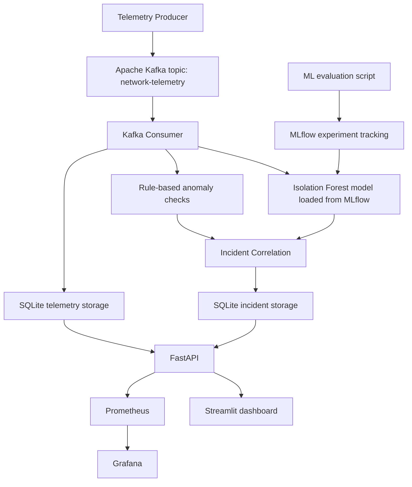

# Network AIOps — Intelligent Network Operations

An end-to-end Network AIOps prototype that streams synthetic network telemetry, detects anomalies with Isolation Forest and threshold-based rules, groups alerts into incidents, exposes API and application metrics, and visualizes operations through Streamlit and Grafana.

> **Project status:** Local portfolio prototype. Evaluation currently uses synthetic telemetry, not production network traffic. Results should not be interpreted as validated performance on a real enterprise network.

## Highlights

- Kafka-based telemetry streaming using Apache Kafka in KRaft mode.
- Python producer generates network telemetry events, including injected anomaly scenarios.
- Kafka consumer applies an MLflow-tracked Isolation Forest model and rule-based checks.
- Incident correlation groups alerts by device and issue.
- SQLite stores telemetry and incident records.
- FastAPI exposes health, telemetry, incidents, and Prometheus metrics endpoints.
- Streamlit dashboard shows telemetry, ML predictions, rule alerts, and incident status.
- Prometheus scrapes API metrics; Grafana visualizes request volume, response time, and error-rate metrics.
- Unit tests validate telemetry schema rules.

## Architecture



### Main components

| Component | Responsibility |
|---|---|
| Telemetry producer | Creates synthetic telemetry events and can inject anomaly scenarios |
| Apache Kafka | Buffers and streams events through the `network-telemetry` topic |
| Kafka consumer | Reads events, runs ML and rule-based detection, and persists results |
| Isolation Forest | Unsupervised anomaly detection using network metric features |
| Rule checks | Flags configured threshold breaches such as high latency, packet loss, or interface errors |
| Incident correlation | Groups related alerts by device and issue and updates incident counts/timestamps |
| SQLite | Local persistence for telemetry and incident data |
| FastAPI | Health, telemetry, incident, and metrics endpoints |
| Streamlit | Operations overview, telemetry explorer, and incident management UI |
| Prometheus | Scrapes and stores time-series API metrics |
| Grafana | Visualizes API request counts, response times, and error-rate metrics |
| MLflow | Tracks model-evaluation runs and stores model artifacts |

## Technology stack

- Python
- Apache Kafka (Docker Compose)
- scikit-learn / Isolation Forest
- MLflow
- pandas and joblib
- FastAPI and Uvicorn
- Streamlit
- SQLite
- Prometheus
- Grafana
- Docker Compose
- `unittest`

## Telemetry features

The current model uses these four numeric features:

- `latency_ms`
- `packet_loss_pct`
- `bandwidth_mbps`
- `interface_errors`

Synthetic events can include normal conditions and injected anomaly types such as high latency, packet loss, and high interface errors.

## ML evaluation

The evaluation dataset is synthetic and contains 1,000 events, with 900 generated as normal and 100 generated as anomalies. The evaluation script compares Isolation Forest contamination settings using an 80/20 train/test split with `random_state=42`.

The candidate run selected for the consumer used `contamination=0.10`. Its recorded test metrics were:

| Metric | Value |
|---|---:|
| Accuracy | 0.98 |
| Precision | 0.90 |
| Recall | 0.90 |
| F1 score | 0.90 |
| True positives | 18 |
| False negatives | 2 |
| False positives | 2 |
| True negatives | 178 |

**Important interpretation:** These are results on generated data whose anomaly patterns are synthetic. They do not establish the same performance on real enterprise network telemetry. Real-world validation would require representative labelled traffic, drift analysis, and careful threshold/model tuning.

Rule-based detection also performed well against the generated examples because the synthetic anomaly ranges were designed to align with configured thresholds. This is not independent evidence of production accuracy.

## Prerequisites

- Windows with PowerShell and VS Code (the current development environment).
- Python installed at the path configured in `start_aiops.bat`, or update that variable to your environment.
- Docker Desktop running with Docker Compose available.
- Project Python dependencies installed in the selected virtual environment.
- The local `mlflow.db` tracking database and selected model run/artifact accessible to the consumer.

This project was developed and tested locally. Resource usage can be significant on a machine with 8 GB RAM, so avoid running additional heavy services unless needed.

## Start the project

From the project root:

```powershell
cd D:\Internship\MyOwnProject\NetworkAIOps
```

Activate the environment used by the project (adjust if your environment path differs):

```powershell
& "D:\Python Programs\venv\Scripts\Activate.ps1"
```

Start Kafka, Prometheus, and Grafana:

```powershell
docker compose up -d
```

The current launcher starts the Kafka consumer, FastAPI, and Streamlit in separate terminal windows:

```powershell
.\start_aiops.bat
```

Keep the three Python service windows open while using the application. The launcher expects `mlflow.db` in the project root.

### Local URLs

| Service | URL |
|---|---|
| Streamlit dashboard | http://localhost:8501 |
| FastAPI health | http://127.0.0.1:8000/health |
| FastAPI docs | http://127.0.0.1:8000/docs |
| API metrics | http://127.0.0.1:8000/metrics |
| Prometheus targets | http://localhost:9090/targets |
| Prometheus UI | http://localhost:9090 |
| Grafana | http://localhost:3000 |
| MLflow UI | http://127.0.0.1:5000 |

The MLflow UI is started separately when needed:

```powershell
mlflow ui --backend-store-uri sqlite:///mlflow.db --host 127.0.0.1 --port 5000
```

## Generate sample telemetry

With Kafka and the consumer running, open another PowerShell terminal in the project root and run:

```powershell
python .\src\kafka_producer.py --count 5 --interval 1 --anomaly-every 2
```

The producer prints each published event. Refresh the Streamlit dashboard to view newly processed telemetry and alerts.

The producer may display a `DeprecationWarning` about `value_serializer`; this warning did not prevent event publishing during current local tests, but the serializer implementation can be modernized later.

## Run unit tests

From the project root, with the project environment activated:

```powershell
python -m unittest discover -s tests -v
```

At the latest verification checkpoint, all five telemetry schema tests passed:

- valid event accepted
- missing field rejected
- negative latency rejected
- invalid packet loss rejected
- invalid interface errors rejected

## API endpoints

The currently verified endpoints include:

| Endpoint | Purpose |
|---|---|
| `GET /health` | Reports API health and whether the database file exists |
| `GET /telemetry` | Retrieves telemetry records; supports query filters such as `limit`, `device_id`, and `anomaly_only` |
| `GET /incidents` | Retrieves incidents |
| `GET /incidents/{incident_id}` | Retrieves a specific incident |
| `GET /metrics` | Exposes Prometheus-format application metrics |

See `/docs` for the API's interactive OpenAPI documentation.

## Monitoring

FastAPI exposes metrics including:

- `network_aiops_http_requests_total`
- `network_aiops_http_request_duration_seconds`

Prometheus is configured to scrape `host.docker.internal:8000`. The target was verified as **UP** during local testing. Grafana charts were also observed updating after API requests and fresh telemetry activity.

A browser request for `/favicon.ico` may appear as HTTP 404 in request metrics; this is typically a non-critical missing browser icon request rather than an application endpoint failure.

## Current limitations and next steps

- Telemetry and ML evaluation data are synthetic; no real network devices or production traffic have been validated.
- The current model and threshold values need evaluation against representative labelled data before operational use.
- Add tests for API routes, consumer error handling, malformed Kafka messages, restart behavior, and duplicate processing.
- Verify persistence by restarting Python services and confirming saved telemetry/incidents remain available.
- Improve dashboard time-axis readability and validate the API error-rate PromQL query.
- Add a clear model/version management procedure and monitor data drift and anomaly rates.
- Add an architecture image, screenshots, dependency lock file, and reproducible environment setup.
- Kubernetes orchestration is intentionally deferred while keeping local resource use manageable.

## Repository structure

The following is a simplified description of the project structure; filenames may evolve as the project grows.

```text
NetworkAIOps/
├── data/
├── models/
├── prometheus/
│   └── prometheus.yml
├── src/
│   ├── api.py
│   ├── dashboard.py
│   ├── kafka_consumer.py
│   ├── kafka_producer.py
│   ├── telemetry_consumer.py
│   ├── telemetry_producer.py
│   ├── incident_correlator.py
│   └── ...
├── tests/
├── docker-compose.yml
├── start_aiops.bat
└── README.md
```

## Portfolio summary

**Network AIOps** demonstrates an end-to-end local engineering workflow combining streaming data, unsupervised anomaly detection, rule-based alerting, incident correlation, REST APIs, a dashboard, experiment tracking, and application monitoring.

The current implementation is a portfolio prototype built and verified with synthetic telemetry. Production readiness would require additional reliability, security, scaling, and real-data validation work.
